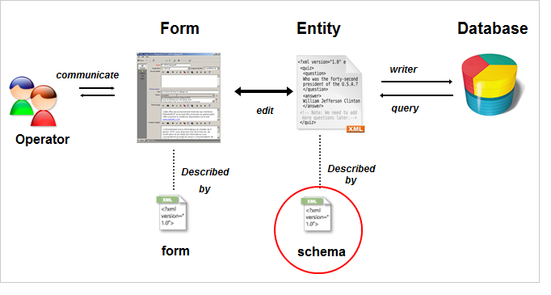

# Erste Schritte mit Schemata {#about-schema-reference}

## Was ist ein Schema {#what-is-a-schema}

In diesem Kapitel wird beschrieben, wie Sie Erweiterungsschemata konfigurieren können, um das konzeptionelle Datenmodell der Adobe Campaign-Datenbank zu erweitern.

Genauere Informationen zu den integrierten Campaign-Tabellen und ihrer Interaktion finden Sie im [Campaign Classic-Datenmodell](https://experienceleague.adobe.com/de/docs/campaign/campaign-v8/developer/datamodel){target="_blank"} (Dokumentation zu Campaign v8).

In Adobe Campaign wird die physische und logische Struktur der im Programm übertragenen Daten in XML beschrieben. Ein **Schema** ist ein XML-Dokument, das mit einer Datenbanktabelle verknüpft ist. Es definiert die Datenstruktur und beschreibt die SQL-Definition der Tabelle:

* Der Name der Tabelle
* Felder
* Indizes
* Relationen zu anderen Tabellen

Außerdem wird die XML-Struktur zum Speichern von Daten beschrieben:

* Elemente und Attribute
* Hierarchie der Elemente
* Element- und Attributtypen
* Standardwerte
* Titel, Beschreibungen und andere Eigenschaften.

Mit Schemata können Sie eine Entität in der Datenbank definieren. Es gibt ein Schema für jede Entität.

Die folgende Abbildung zeigt den Speicherort von Schemas im Adobe Campaign-Datensystem:

>[!NOTE]
>
>Im Zuge der Umstellung von Campaign v7 auf v8 wurde die Campaign Classic-Dokumentation optimiert und neu organisiert. Allgemeine Funktionen sind jetzt nur noch in der Dokumentation zu Campaign v8 verfügbar. Informationen zur Syntax und Identifizierung von Schemata finden Sie in der [Dokumentation zu Campaign v8](https://experienceleague.adobe.com/de/docs/campaign/campaign-v8/developer/schemas-forms/schemas){target=_blank}.
>
>{target=_blank}
