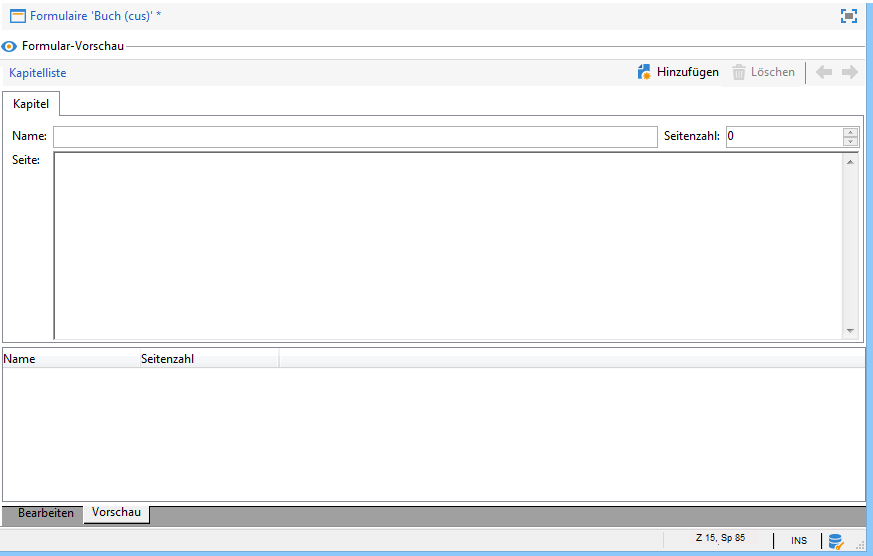
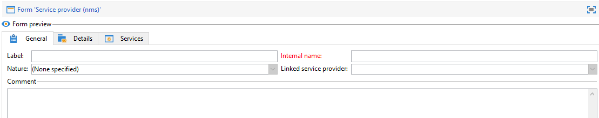
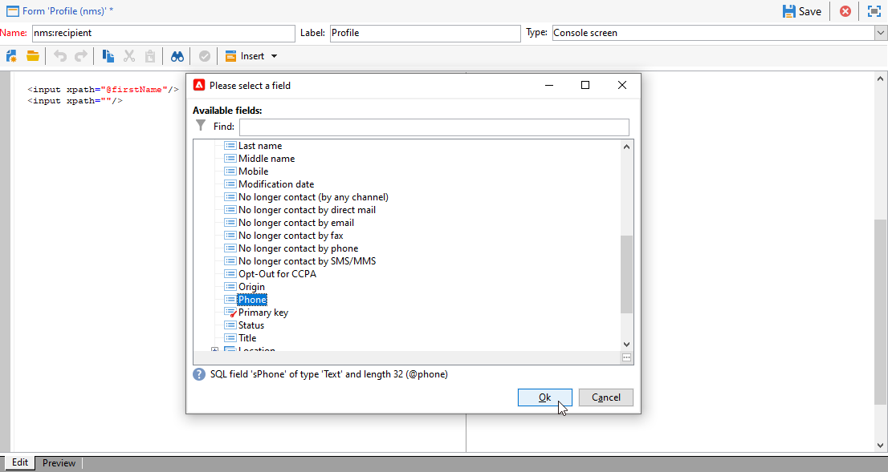
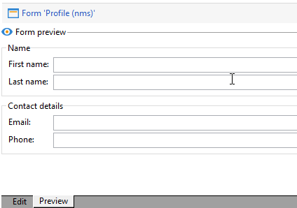

# Bearbeiten von Formularen{#editing-forms}

## Übersicht

Marketer und Operatoren verwenden Eingabeformulare, um Datensätze zu erstellen, zu ändern und in der Vorschau anzuzeigen. Forms zeigt eine visuelle Darstellung von Informationen an.

Im Zuge der Umstellung von Campaign v7 auf v8 wurde die Campaign Classic-Dokumentation optimiert und neu organisiert. Allgemeine Funktionen sind jetzt nur noch in der Dokumentation zu Campaign v8 verfügbar. Weitere Informationen zu Eingabeformularen finden Sie in der [Dokumentation zu Campaign v8](https://experienceleague.adobe.com/de/docs/campaign/campaign-v8/developer/schemas-forms/forms){target=_blank}.

[](https://experienceleague.adobe.com/de/docs/campaign/campaign-v8/developer/schemas-forms/forms){target=_blank}

Sie können Formulare erstellen und ändern:

* Sie können die werkseitigen Eingabeformulare ändern, die standardmäßig bereitgestellt werden. Die werkseitigen Eingabeformulare basieren auf den werkseitigen Datenschemata.
* Sie können benutzerdefinierte Eingabeformulare erstellen, die auf von Ihnen definierten Datenschemata basieren.

Forms sind Entitäten `xtk:form` Typs. Sie können die Struktur des Eingabeformulars im `xtk:form`-Schema anzeigen. Um dieses Schema anzuzeigen, wählen Sie **[!UICONTROL Administration]** > **[!UICONTROL Konfiguration]** > **[!UICONTROL Datenschemata]** aus dem Menü aus. Weitere Informationen über [Formularstruktur](https://experienceleague.adobe.com/de/docs/campaign/campaign-v8/developer/schemas-forms/forms){target="_blank"} (Dokumentation zu Campaign v8).

Um auf Eingabeformulare zuzugreifen, wählen Sie **[!UICONTROL Administration] > [!UICONTROL Konfiguration] > [!UICONTROL Eingabeformulare]** aus dem Menü:


Um Formulare zu entwerfen, bearbeiten Sie den XML-Inhalt im XML-Editor:


[Weitere Informationen](https://experienceleague.adobe.com/de/docs/campaign/campaign-v8/developer/schemas-forms/forms#formatting){target="_blank"} (Dokumentation zu Campaign v8).

Um ein Formular in der Vorschau anzuzeigen, klicken Sie auf die **[!UICONTROL Vorschau]**:


## Formulartypen

Sie können verschiedene Arten von Eingabeformularen erstellen. Der Formulartyp bestimmt, wie Benutzer im Formular navigieren:

* Konsolen-Bildschirm

  Dies ist der Standardformulartyp. Das Formular besteht aus einer einzelnen Seite.

  

* Content-Management

  Verwenden Sie diesen Formulartyp für das Content-Management. Siehe diesen [Anwendungsfall](../../delivery/using/use-case-creating-content-management.md).

  

* Assistent

  Dieses Formular umfasst mehrere unverankerte Bildschirme, die in einer bestimmten Reihenfolge angeordnet sind. Benutzer navigieren von einem Bildschirm zum nächsten. [Weitere Informationen](https://experienceleague.adobe.com/de/docs/campaign/campaign-v8/developer/schemas-forms/forms#wizards){target="_blank"} (Dokumentation zu Campaign v8).

* Iconbox

  Dieses Formular umfasst mehrere Seiten. Um im Formular zu navigieren, klicken Benutzer auf die Symbole links neben dem Formular.

  

* Notebook

  Dieses Formular umfasst mehrere Seiten. Um im Formular zu navigieren, wählen Benutzer Registerkarten oben im Formular aus.

  

* Vertikale Trennung

  Dieses Formular zeigt einen Navigationsbaum an.

* Horizontale Trennung

  Dieses Formular zeigt eine Liste von Elementen an.

## Verweise auf Bilder

Um Bilder zu finden, wählen Sie **[!UICONTROL Administration]** > **[!UICONTROL Konfiguration]** > **[!UICONTROL Bilder]** aus dem Menü aus.

Um ein Bild mit einem Element im Formular zu verknüpfen, z. B. mit einem Symbol, können Sie einen Verweis auf ein Bild hinzufügen. Verwenden Sie das `img`-Attribut beispielsweise im `<container>`.

Syntax: `img="`*`namespace`*`:`*`filename`*`.`*`extension`*`"`

Dieses Beispiel zeigt Verweise auf die `book.png` und `detail.png` Bilder aus dem `ncm` Namespace:

```xml
<container img="ncm:book.png" label="General">
[…]
</container>
<container img="ncm:detail.png" label="Details">
[…]
</container>
```

Diese Bilder werden für Symbole verwendet, auf die Benutzer klicken, um in einem mehrseitigen Formular zu navigieren:


## Einfaches Formular erstellen {#create-simple-form}

Gehen Sie wie folgt vor, um ein Formular zu erstellen:

1. Wählen Sie im Menü **[!UICONTROL Administration]** > **[!UICONTROL Konfiguration]** > **[!UICONTROL Formulare]**.
1. Klicken Sie **[!UICONTROL oben rechts in]** Liste auf „Neu“.

   

1. Geben Sie die Formulareigenschaften an:

   * Geben Sie den Formularnamen und den Namespace an.

     Der Formularname und der Namespace können mit dem zugehörigen Datenschema übereinstimmen.  Dieses Beispiel zeigt ein Formular für das `cus:order` Datenschema:

     ```xml
     <form entitySchema="xtk:form" img="xtk:form.png" label="Order" name="order" namespace="cus" type="iconbox" xtkschema="xtk:form">
       […]
     </form>
     ```

     Alternativ können Sie das Datenschema explizit im `entity-schema` angeben.

     ```xml
     <form entity-schema="cus:stockLine" entitySchema="xtk:form" img="xtk:form.png" label="Stock order" name="stockOrder" namespace="cus" xtkschema="xtk:form">
       […]
     </form>
     ```

   * Geben Sie den Titel an, der auf dem Formular angezeigt werden soll.
   * Geben Sie optional den Formulartyp an. Wenn Sie keinen Formulartyp angeben, wird standardmäßig der Konsolenbildschirmtyp verwendet.

     

     Wenn Sie ein mehrseitiges Formular entwerfen, können Sie den Formulartyp im `<form>` auslassen und den Typ in einem Container angeben.

1. Klicken Sie auf **[!UICONTROL Speichern]**.

1. Fügen Sie die Formularelemente ein.

   Um beispielsweise ein Eingabefeld einzufügen, verwenden Sie das `<input>`. Legen Sie das `xpath`-Attribut als XPath-Ausdruck auf den Feldverweis fest. [Weitere Informationen](https://experienceleague.adobe.com/de/docs/campaign/campaign-v8/developer/schemas-forms/schema-structure#reference-with-xpath){target="_blank"} (Dokumentation zu Campaign v8).

   Dieses Beispiel zeigt Eingabefelder, die auf dem `nms:recipient` basieren.

   ```xml
   <input xpath="@firstName"/>
   <input xpath="@lastName"/>
   ```

1. Wenn das Formular auf einem bestimmten Schematyp basiert, können Sie die Felder für dieses Schema nachschlagen:

   1. Klicken Sie **[!UICONTROL Einfügen]** > **[!UICONTROL Dokumentfelder]**.

      

   1. Wählen Sie das Feld aus und klicken Sie auf **[!UICONTROL OK]**.

      

1. Geben Sie optional den Feldeditor an.

   Jedem Datentyp ist ein Standardeditor für Felder zugeordnet:
   * Für ein Feld vom Typ Datum zeigt das Formular einen Eingabekalender an.
   * Für ein Feld vom Typ Auflistung zeigt das Formular eine Auswahlliste an.

   Sie können die folgenden Typen von Feldeditoren verwenden:

   | Feld-Editor | Formularattribut |
   | --- | --- |
   | Optionsfeld | `type="radiobutton"` |
   | Kontrollkästchen | `type="checkbox"` |
   | Baum bearbeiten | `type="tree"` |

   Weitere Informationen [Speicherlisten-Steuerelemente](https://experienceleague.adobe.com/de/docs/campaign/campaign-v8/developer/schemas-forms/forms#memory-list-controls){target="_blank"} (Dokumentation zu Campaign v8).

1. Definieren Sie optional den Zugriff auf die Felder:

   | Element | Attribut | Beschreibung |
   | --- | --- | --- |
   | `<input>` | `read-only="true"` | Bietet schreibgeschützten Zugriff auf ein Feld |
   | `<container>` | `type="visibleGroup" visibleIf="`*edit-expr*`"` | Zeigt bedingt eine Gruppe von Feldern an |
   | `<container>` | `type="enabledGroup" enabledIf="`*edit-expr*`"` | Bedingte Aktivierung einer Feldergruppe |

   Beispiel:

   ```xml
   <container type="enabledGroup" enabledIf="@gender=1">
     […]
   </container>
   <container type="enabledGroup" enabledIf="@gender=2">
     […]
   </container>
   ```

1. Verwenden Sie optional Container, um Felder in Abschnitte zu gruppieren.

   ```xml
   <container type="frame" label="Name">
      <input xpath="@firstName"/>
      <input xpath="@lastName"/>
   </container>
   <container type="frame" label="Contact details">
      <input xpath="@email"/>
      <input xpath="@phone"/>
   </container>
   ```

   

## Erstellen eines mehrseitigen Formulars {#create-multipage-form}

Sie können mehrseitige Formulare erstellen. Sie können Formulare auch in anderen Formularen verschachteln. Lesen Sie mehr über [Container, Notebooks und iconbox-Formulare](https://experienceleague.adobe.com/de/docs/campaign/campaign-v8/developer/schemas-forms/forms#containers){target="_blank"} (Dokumentation zu Campaign v8).

## Ändern eines werkseitigen Eingabeformulars {#modify-factory-form}

Gehen Sie wie folgt vor, um ein Factory-Formular zu ändern:

1. Ändern des werkseitigen Eingabeformulars:

   1. Wählen Sie im Menü **[!UICONTROL Administration]** > **[!UICONTROL Konfiguration]** > **[!UICONTROL Formulare]**.
   1. Wählen Sie ein Eingabeformular aus und ändern Sie es.

   Sie können Factory-Datenschemata erweitern, aber nicht Factory-Eingabeformulare. Es wird empfohlen, die werkseitigen Eingabeformulare direkt zu ändern, ohne sie neu zu erstellen. Bei Software-Upgrades werden Ihre Änderungen in den werkseitigen Eingabeformularen mit den Upgrades zusammengeführt. Wenn die automatische Zusammenführung fehlschlägt, können Sie die Konflikte auflösen. [Weitere Informationen](../../production/using/upgrading.md#resolving-conflicts)

   Wenn Sie beispielsweise ein Factory-Schema mit einem zusätzlichen Feld erweitern, können Sie dieses Feld dem zugehörigen Factory-Formular hinzufügen.

## Formulare validieren {#validate-forms}

Sie können Validierungssteuerelemente in Formulare einbeziehen.

### Pflichtfelder überprüfen

Sie können die obligatorischen Informationen überprüfen:

* Verwenden Sie das Attribut `required="true"` für die erforderlichen Felder.
* Verwenden Sie den Knoten `<leave>` , um diese Felder zu überprüfen und Fehlermeldungen anzuzeigen.

In diesem Beispiel ist die E-Mail-Adresse erforderlich und eine Fehlermeldung wird angezeigt, wenn der Benutzer diese Informationen nicht bereitgestellt hat:

```xml
<input xpath="@email" required="true"/>
<leave>
  <check expr="@email!=''">
    <error>The email address is required.</error>
  </check>
</leave>
```

Lesen Sie mehr über [Ausdrucksfelder](https://experienceleague.adobe.com/de/docs/campaign/campaign-v8/developer/schemas-forms/forms#expression-field){target="_blank"} (Dokumentation zu Campaign v8) und [Formularkontext](https://experienceleague.adobe.com/de/docs/campaign/campaign-v8/developer/schemas-forms/forms#context-of-forms){target="_blank"} (Dokumentation zu Campaign v8).

### Validieren von Werten

Sie können JavaScript SOAP-Aufrufe verwenden, um Formulardaten in der Konsole zu überprüfen. Verwenden Sie diese Aufrufe für eine komplexe Validierung, z. B. um einen Wert mit einer Liste autorisierter Werte zu vergleichen. [Weitere Informationen](https://experienceleague.adobe.com/de/docs/campaign/campaign-v8/developer/schemas-forms/forms#soap-methods){target="_blank"} (Dokumentation zu Campaign v8).

1. Erstellen Sie eine Validierungsfunktion in einer JS-Datei.

   Beispiel:

   ```js
   function nms_recipient_checkValue(value)
   {
     logInfo("checking value " + value)
     if (…)
     {
       logError("Value " + value + " is not valid")
     }
     return 1
   }
   ```

   In diesem Beispiel trägt die Funktion den Namen `checkValue`. Mit dieser Funktion wird der `recipient` Datentyp im `nms`-Namespace überprüft. Der zu überprüfende Wert wird protokolliert. Wenn der Wert ungültig ist, wird eine Fehlermeldung protokolliert. Wenn der Wert gültig ist, wird der Wert 1 zurückgegeben.

   Sie können den zurückgegebenen Wert verwenden, um das Formular zu ändern.

1. Fügen Sie im Formular das `<soapCall>` Element zum `<leave>` Element hinzu.

   In diesem Beispiel wird ein SOAP-Aufruf verwendet, um die `@valueToCheck` Zeichenfolge zu validieren:

   ```xml
   <form name="recipient" (…)>
   (…)
     <leave>
       <soapCall name="checkValue" service="nms:recipient">
         <param exprIn="@valueToCheck" type="string"/>
       </soapCall>
     </leave>
   </form>
   ```

   In diesem Beispiel werden die `checkValue`-Methode und der `nms:recipient`-Service verwendet:

   * Der Service ist der Namespace und der Datentyp.
   * Die Methode ist der Funktionsname. Beim Namen wird zwischen Groß- und Kleinschreibung unterschieden.

   Der Aufruf erfolgt synchron.

   Alle Ausnahmen werden angezeigt. Wenn Sie das `<leave>` verwenden, können Benutzer das Formular erst speichern, nachdem die eingegebenen Informationen validiert wurden.

Dieses Beispiel zeigt, wie Sie Service-Aufrufe in Formularen durchführen können:

```xml
<enter>
  <soapCall name="client" service="c4:ybClient">
    <param exprIn="@id" type="string"/>
    <param type="boolean" xpathOut="/tmp/@count"/>
  </soapCall>
</enter>
```

In diesem Beispiel ist die Eingabe eine ID, bei der es sich um einen Primärschlüssel handelt. Wenn Benutzende das Formular für diese ID ausfüllen, wird ein SOAP-Aufruf mit dieser ID als Eingabeparameter durchgeführt. Die Ausgabe ist ein boolescher Wert, der in dieses Feld geschrieben wird: `/tmp/@count`. Sie können diesen booleschen Wert im Formular verwenden. Weitere Informationen zu [Formularkontext](https://experienceleague.adobe.com/de/docs/campaign/campaign-v8/developer/schemas-forms/forms#context-of-forms){target="_blank"} (Dokumentation zu Campaign v8).
