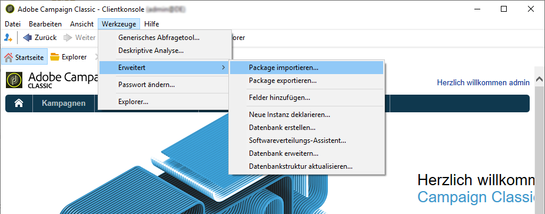
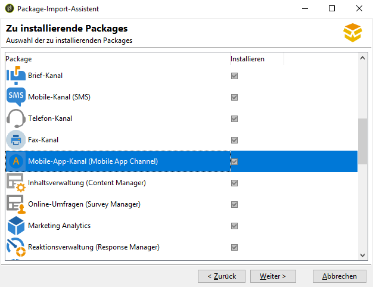
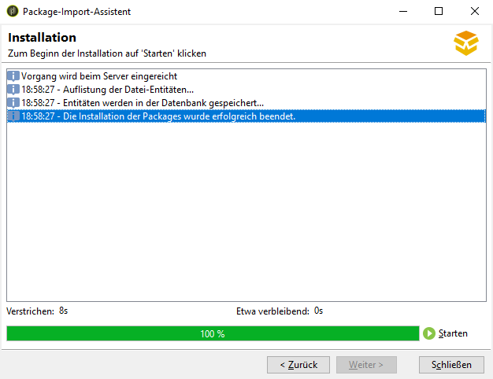

# Erste Schritte mit dem App-Kanal{#about-mobile-app-channel}

Richten Sie mit Adobe Campaign den Versand von Push-Benachrichtigungen ein, um personalisierte Nachrichten an Benutzende Ihrer App zu senden.

>[!NOTE]
>
>Im Zuge der Umstellung von Campaign v7 auf v8 wurde die Campaign Classic-Dokumentation optimiert und neu organisiert. Allgemeine Funktionen sind jetzt nur noch in der Dokumentation zu Campaign v8 verfügbar. Weitere Informationen zum Push-Benachrichtigungskanal finden Sie in der Dokumentation zu [ v8 ](https://experienceleague.adobe.com/en/docs/campaign/campaign-v8/send/push/push){target=_blank}.
>
>{target="_blank"}

Die folgenden Informationen gelten spezifisch für Campaign Classic.

+++ **Paket-Installation**

 [Video zur Installation des Mobile-App-Package ](https://experienceleague.adobe.com/docs/campaign-classic-learn/tutorials/sending-messages/push-channel/installing-the-mobile-app-channel.html?lang=de#sending-messages)

Wenn Sie Campaign als Hybrid- oder gehostete Bereitstellung nutzen, wenden Sie sich an die [Adobe-Kundenunterstützung](https://helpx.adobe.com/de/enterprise/admin-guide.html/enterprise/using/support-for-experience-cloud.ug.html), um Zugriff auf den Kanal für Push-Benachrichtigungen in Campaign zu erhalten.

Wenn Sie Campaign als On-Premise-Bereitstellung nutzen, müssen Sie ein integriertes Paket installieren.

>[!CAUTION]
>
>Weitere Informationen zu integrierten Campaign-Paketen, Best Practices und Empfehlungen finden Sie auf [dieser Seite](../../installation/using/installing-campaign-standard-packages.md).

Die Installationsschritte sind:

1. Greifen Sie über **[!UICONTROL Werkzeuge > Erweitert > Package-Import]** in der Adobe Campaign-Client-Konsole auf den Package-Import-Assistenten zu.

   

1. Wählen Sie **[!UICONTROL Standard-Package installieren]** aus.

1. Markieren Sie in der angezeigten Liste **[!UICONTROL Mobile-App-Kanal (Mobile App Channel)]**.

   

1. Klicken Sie auf **[!UICONTROL Weiter]** und dann auf **[!UICONTROL Starten]**, um die Package-Installation zu starten.

   Sobald die Packages installiert sind, wird in der Fortschrittsleiste **100 %** angezeigt. Folgende Meldung wird in den Installationsprotokollen angezeigt: **[!UICONTROL Die Installation der Packages wurde erfolgreich beendet]**.

   

1. **[!UICONTROL Schließen]** Sie das Installationsfenster.

Nach Abschluss dieses Schritts können Sie Ihre Android- und iOS-Apps konfigurieren. Weitere Informationen finden Sie in der [Dokumentation zu Campaign v8](https://experienceleague.adobe.com/docs/campaign/campaign-v8/send/push/push.html?lang=de){target="_blank"}.

+++

+++ **Fehlerbehebung**

Wenn Ihr Mobilgerät mit einem WLAN verbunden ist und Sie keine Benachrichtigungen erhalten, stellen Sie sicher, dass die FCM/APNS-Ports nicht von Ihrer Firewall gesperrt werden.

**Android**: Das Mobilgerät stellt eine Verbindung zu den FCM-Servern an den Ports 5228 bis 5230 her. Daher müssen Sie Ihre Firewall so konfigurieren, dass sie die Verbindung mit FCM autorisiert. Die zu öffnenden Ports sind 5228 (am häufigsten verwendet), 5229 und 5230.

**iOS**:

HTTP/2-Connector: Erlauben Sie die Kommunikation zu und von den folgenden Servern:

* api.push.apple.com: Port 443
* api.development.push.apple.com: Port 443

>[!NOTE]
>
>Weitere Informationen zu den beiden Connectoren finden Sie in der [Dokumentation zu Campaign v8](https://experienceleague.adobe.com/docs/campaign/campaign-v8/send/push/push-settings.html?lang=de){target="_blank"}.

+++
