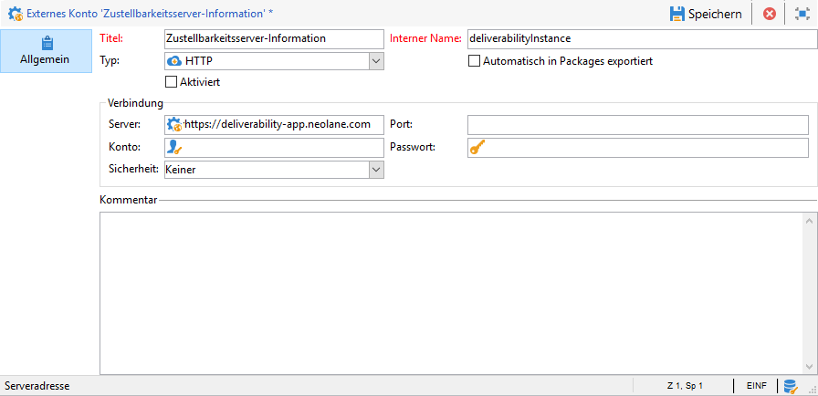

# Rendering im Posteingang{#inbox-rendering}

Adobe Campaign nutzt die [Litmus](https://litmus.com/email-testing) Web-basierte E-Mail-Testlösung, um E-Mail-Renderings zu erfassen und in einem dedizierten Bericht verfügbar zu machen.

Im Zuge der Umstellung von Campaign v7 auf v8 wurde die Campaign Classic-Dokumentation optimiert und neu organisiert. Allgemeine Funktionen sind jetzt nur noch in der Dokumentation zu Campaign v8 verfügbar. Weitere Informationen zum Inbox Rendering finden Sie in der [Campaign v8-Dokumentation](https://experienceleague.adobe.com/de/docs/campaign/campaign-v8/send/deliverability-management/inbox-rendering){target=_blank}.

[](https://experienceleague.adobe.com/de/docs/campaign/campaign-v8/send/deliverability-management/inbox-rendering){target=_blank}

## Inbox Rendering aktivieren {#activating-inbox-rendering}

[!BADGE Hybrid und On-Premise]{type=Caution url="https://experienceleague.adobe.com/docs/campaign-classic/using/installing-campaign-classic/architecture-and-hosting-models/hosting-models-lp/hosting-models.html?lang=de" tooltip="Gilt nur für Hybrid- und On-Premise-Bereitstellungen"}

Für gehostete und hybride Clients wird das Inbox Rendering auf Ihrer Instanz vom technischen Support und von Beratern von Adobe konfiguriert. Weiterführende Informationen dazu erhalten Sie von Ihrem Adobe-Kundenbetreuer.

Gehen Sie bei On-Premise-Installationen wie folgt vor, um das Inbox Rendering zu konfigurieren.

1. Installieren Sie das **[!UICONTROL Inbox Rendering (IR)]**-Package über das Menü **[!UICONTROL Tools]** > **[!UICONTROL Erweitert]** > **[!UICONTROL Package-Import]**. Weitere Informationen hierzu finden Sie unter [Installieren von nativen Campaign Classic-Packages](../../installation/using/installing-campaign-standard-packages.md).
1. Konfigurieren Sie ein externes HTTP-Konto über den Knoten **[!UICONTROL Administration]** > **[!UICONTROL Plattform]** > **[!UICONTROL Externe Konten]**. Weitere Informationen hierzu finden Sie unter [Externes Konto erstellen](../../installation/using/external-accounts.md#creating-an-external-account).
1. Legen Sie die Parameter für das externe Konto wie folgt fest:
   * **[!UICONTROL Titel]**: Zustellbarkeits-Server-Information
   * **[!UICONTROL Interner Name]**: deliverabilityInstance
   * **[!UICONTROL Typ]**: HTTP
   * **[!UICONTROL Server]**: https://deliverability-app.neolane.net/deliverability
   * **[!UICONTROL Verschlüsselung]**: Keine
   * Kreuzen Sie die Option **[!UICONTROL Aktiviert]** an.

   

1. Wechseln Sie zum Knoten **[!UICONTROL Administration]** > **[!UICONTROL Plattform]** > **[!UICONTROL Optionen]**. Suchen Sie nach der Option **[!UICONTROL DmRendering_cuid]** und wenden Sie sich an den Support, um die ID der Versandberichte abzurufen, die in das Feld **[!UICONTROL Wert (Text)]** kopiert werden muss.
1. Bearbeiten Sie die Datei **serverConf.xml**, um einen Aufruf an den Litmus-Server zuzulassen. Fügen Sie dem Abschnitt `<urlPermission>` die folgende Zeile hinzu:

   ```
   <url dnsSuffix="deliverability-app.neolane.net" urlRegEx="https://.*"/>
   ```

1. Laden Sie die Konfiguration mit dem folgenden Befehl neu:

   ```
   nlserver config -reload
   ```

>[!NOTE]
>
>Möglicherweise müssen Sie sich von der Konsole abmelden und sich wieder anmelden, um das Inbox Rendering verwenden zu können.
