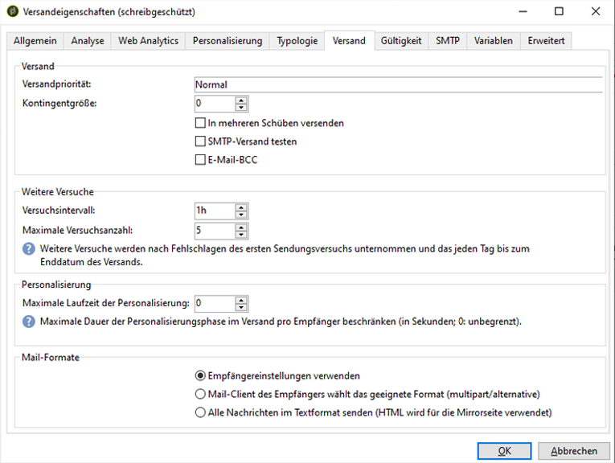
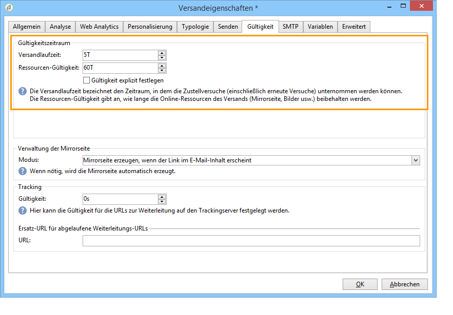

# Konfigurieren und Durchführen des Versands {#configuring-and-sending-the-delivery}

Auf dieser Seite werden die Versandeinstellungen beschrieben, die für On-Premise- und Hybridinstallationen von Campaign Classic v7 spezifisch sind.

Im Zuge der Umstellung von Campaign v7 auf v8 wurde der Campaign Classic-Dokumentationssatz optimiert und neu organisiert. Allgemeine Funktionen sind jetzt nur noch in der Dokumentation zu Campaign v8 verfügbar. Weitere Informationen zu den Versandeinstellungen finden Sie in der [ zu Campaign v8](https://experienceleague.adobe.com/en/docs/campaign/campaign-v8/send/validate/configure-and-send){target=_blank}.

{target=_blank}

## Zusätzliche Versandparameter {#delivery-additiona-parameters}

Vor der Durchführung des Versands können Sie im Tab **[!UICONTROL Versand]** die Parameter der Versandeigenschaften definieren.

* **[!UICONTROL SMTP-Versand testen]**: Verwenden Sie diese Option, um den Versand per SMTP zu testen. Der Versand wird bis zur Verbindung mit dem SMTP-Server verarbeitet, aber nicht gesendet: Für jeden Empfänger des Versands stellt Campaign eine Verbindung mit dem Server des SMTP-Anbieters her, führt den SMTP-Befehl RCPT TO aus und schließt die Verbindung vor dem SMTP-Befehl DATA.

  >[!NOTE]
  >
  >* Diese Option darf bei Mid-Sourcing nicht festgelegt werden.
  >
  >* Weitere Informationen zur SMTP-Server-Konfiguration finden Sie in [diesem Abschnitt](../../installation/using/configure-delivery-settings.md).

## Konfigurieren der weiteren Zustellversuche {#configuring-retries}

>[!IMPORTANT]
>
>Bei gehosteten oder hybriden Installationen werden die Einstellungen für den erneuten Versuch im Versand nicht mehr von Campaign verwendet, wenn Sie auf den [Enhanced MTA](sending-with-enhanced-mta.md) aktualisiert haben. Weitere Zustellversuche aufgrund von Softbounces sowie die Zeitdauer zwischen ihnen werden durch den Enhanced MTA bestimmt, basierend auf Typ und Prioritätsstufe der Bounce-Antworten, die von der E-Mail-Domain der Nachricht zurückgegeben werden.

Bei On-Premise-Installationen und gehosteten/hybriden Installationen, die den bestehenden Campaign-MTA verwenden, gibt der zentrale Abschnitt der Registerkarte **[!UICONTROL Versand]** für die Versandparameter an, wie viele weitere Versuche am Tag nach dem Versand durchgeführt werden sollen, und den Mindestzeitabstand zwischen den Versuchen.

Standardmäßig sind innerhalb der ersten 24 Stunden des Versands fünf erneute Versuche im Abstand von mindestens einer Stunde vorgesehen. An den folgenden Tagen wird bis zum Ablauf der Versandgültigkeit, die auf der Registerkarte **[!UICONTROL Gültigkeit]** festgelegt wird, jeweils ein Zustellversuch unternommen. Siehe [Definieren des Gültigkeitszeitraums](#defining-validity-period).

## Definieren des Gültigkeitszeitraums {#defining-validity-period}

Nach dem Start des Versands können die Nachrichten (und alle weiteren Zustellversuche) bis zum Ablauf der Versandgültigkeit gesendet werden. Dies wird auf der Registerkarte **[!UICONTROL Gültigkeit]** der Versandeigenschaften festgelegt.

* Im Feld **[!UICONTROL Versandlaufzeit]** kann die Zeitspanne angegeben werden, in der weitere globale Zustellversuche unternommen werden. Dies bedeutet, dass Adobe Campaign die Nachrichten ab dem Startdatum versendet und dann nur für Nachrichten, die einen Fehler zurückgeben, regelmäßige, konfigurierbare weitere Zustellversuche durchführt, bis die Gültigkeitsgrenze erreicht ist.

  >[!IMPORTANT]
  >
  >Wenn Sie auf den [Enhanced MTA](sending-with-enhanced-mta.md) aktualisiert haben, wird bei gehosteten oder hybriden Installationen die Einstellung **[!UICONTROL Versandlaufzeit]** in Ihren Campaign-E-Mail-Sendungen nur verwendet, wenn sie auf **3,5 Tage oder weniger** festgelegt ist. Wenn Sie einen Wert von mehr als 3,5 Tagen definieren, wird dieser nicht berücksichtigt.

* **Gültigkeit von Ressourcen**: Das Feld **[!UICONTROL Gültigkeit]** wird für hochgeladene Ressourcen verwendet, hauptsächlich für die Mirrorseite und Bilder. Die Gültigkeitsdauer der Ressourcen auf dieser Seite ist begrenzt, um Speicherkapazität zu sparen.

  Die Werte in diesem Feld können in den folgenden Einheiten ausgedrückt werden: **s** für Sekunden, **m** für Minuten, **h** für Stunden, **d** für Tage (Standard), **y** für Jahre.
