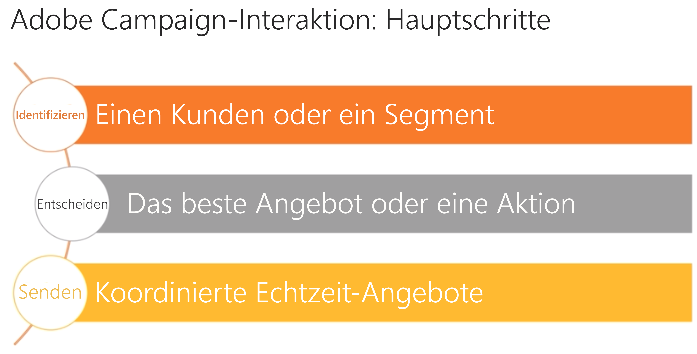

# Interaction und Angebotsverwaltung{#interaction-and-offer-management}

Interaction ermöglicht es Ihnen, während einer Interaktion mit einem bestimmten Kontakt (einer Kundin bzw. einem Kunden oder einer Zielgruppe) in Echtzeit zu reagieren, indem Sie ein einzelnes oder mehrere angepasste Angebote unterbreiten. Bei diesen Angeboten kann es sich beispielsweise um einfache Kommunikationsnachrichten, Sonderangebote für ein oder mehrere Produkte oder einen Service handeln.

Angebote können sowohl bei eingehenden Kontakten (über eine Website, einen Anruf im Callcenter) als auch ausgehenden Kontakten (E-Mail-, Briefpost- oder SMS-Versand im Rahmen einer Marketing-Kampagne) unterbreitet werden.

Sie können einen mit Ihren Inbound- und Outbound-Kanälen verbundenen Angebotskatalog erstellen, um das beste Angebot für einen Kontakt in einem bestimmten Kontext auszuwählen. Die Relevanz eines Angebots für eine Empfängerin bzw. einen Empfänger ist basierend auf Eignungsregeln definiert. Die Auswahl eines Angebots aus einem Paket relevanter Angebote wird mithilfe von Prioritätsregeln bestimmt. Die Regeln zur Angebotsunterbreitung berücksichtigen den Versandverlauf des Kontakts und helfen zu vermeiden, dass der Kontakt nicht mehrmals dasselbe Angebot erhält.

Interaction ermöglicht Ihnen die Erstellung und Verwaltung eines Angebotskatalogs sowie die Konfiguration der Eignungsregeln und der mit ihnen verknüpften Anwendungsthemen. Je nach ausgewähltem Kanal kann der Angebotsinhalt mithilfe verschiedener Rendering-Funktionen personalisiert werden. Schließlich können Sie das Simulationsmodul verwenden, um die Wirkung einer Angebotsunterbreitung zu berechnen.

Im Zuge der Umstellung von Campaign v7 auf v8 wurde der Campaign Classic-Dokumentationssatz optimiert und neu organisiert. Allgemeine Funktionen sind jetzt nur noch in der Dokumentation zu Campaign v8 verfügbar. Weitere Informationen zu Interaction finden Sie in der [Dokumentation zu Campaign v8](https://experienceleague.adobe.com/en/docs/campaign/campaign-v8/offers/interaction){target=_blank}.

{target=_blank}

Dieser Abschnitt behandelt nur die Interaktionsfunktionen, die nicht in der Dokumentation zu Campaign v8 beschrieben sind: [Angebotssimulation](about-offers-simulation.md), [Angebotsunterbreitung](managing-offer-presentation.md), [Angebotsgenehmigung](approving-and-activating-an-offer.md), [Angebotsvorlagen](managing-offer-templates.md) [Erweiterte Einstellungen](using-advanced-parameters.md).

 Sehen Sie sich [dieses Video](https://helpx.adobe.com/campaign/classic/how-to/acs-overview.html?playlist=/ccx/v1/collection/product/campaign/classic/segment/digital-marketers/explevel/intermediate/applaunch/get-started/collection.ccx.js&ref=helpx.adobe.com) an, um sich mit den in Campaign Interaction verwendeten Funktionen und Begriffen vertraut zu machen:.

## Verwandte Themen

| Nützliche Seiten | Zusätzliche Ressourcen |
|---|---|
| [Schritte zur Implementierung von Interaction](https://experienceleague.adobe.com/en/docs/campaign/campaign-v8/offers/interaction){target="_blank"} (Dokumentation zu Campaign v8) | [Testen der Angebotsverteilung](../../interaction/using/about-offers-simulation.md) |
| [Live-/Design-Umgebungen](https://experienceleague.adobe.com/en/docs/campaign/campaign-v8/offers/interaction-settings/interaction-env){target="_blank"} (Dokumentation zu Campaign v8) | [Hinzufügen eines Angebots in einer E-Mail](https://experienceleague.adobe.com/en/docs/campaign/campaign-v8/offers/interaction-send-offers){target="_blank"} (Dokumentation zu Campaign v8) |
| [Erstellen von Angebotsplatzierungen](https://experienceleague.adobe.com/en/docs/campaign/campaign-v8/offers/interaction-settings/interaction-offer-spaces){target="_blank"} (Dokumentation zu Campaign v8) | [Anwendungsbeispiel: Hinzufügen eines Angebots auf einer Website](../../interaction/using/offers-on-an-inbound-channel.md) |
