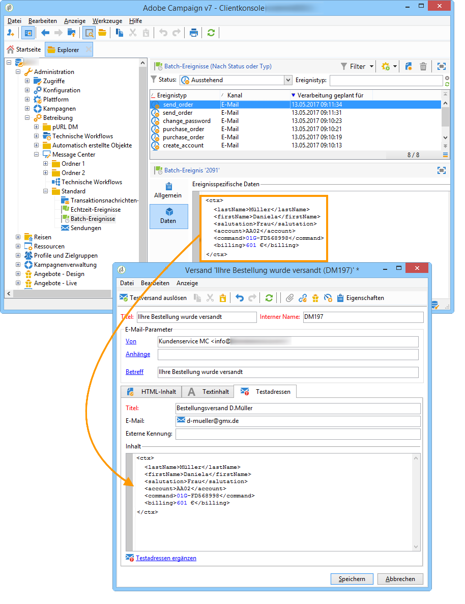
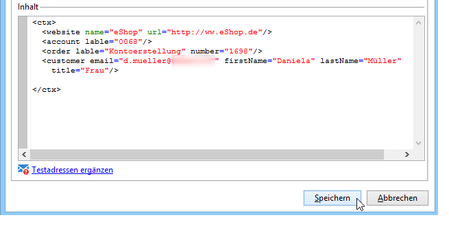

# Testen von Transaktionsnachrichtenvorlagen {#testing-message-templates}

Sobald Ihre [Nachrichtenvorlage](https://experienceleague.adobe.com/en/docs/campaign/campaign-v8/send/real-time/transactional-template){target="_blank"} (Dokumentation zu Campaign v8) fertig ist, führen Sie die folgenden Schritte aus, um sie in der Vorschau anzuzeigen und zu testen.

Im Zuge der Umstellung von Campaign v7 auf v8 wurde der Campaign Classic-Dokumentationssatz optimiert und neu organisiert. Allgemeine Funktionen sind jetzt nur noch in der Dokumentation zu Campaign v8 verfügbar. Informationen zum Hinzufügen von Testadressen, zur Vorschau einer Transaktionsnachricht und zum Senden eines Testversands finden Sie in der [&#x200B; zu Campaign v8](https://experienceleague.adobe.com/en/docs/campaign/campaign-v8/send/real-time/transactional-template#test-message-template){target=_blank}.

{target=_blank}

## Personalisierungsdaten {#personalization-data}

Sie können Daten aus der Nachrichtenvorlage verwenden, um die Personalisierung von Transaktionsnachrichten zu testen. Mit dieser Funktion wird eine Vorschau generiert oder ein Testversand gesendet. Ebenfalls können Sie anzeigen, wie die Nachricht bei verschiedenen Internet-Anbietern dargestellt wird. Weiterführende Informationen dazu finden Sie im Abschnitt [Inbox Rendering](../../delivery/using/inbox-rendering.md).

Der Zweck dieser Daten besteht darin, Ihre Nachrichten vor dem endgültigen Versand zu testen. Bei diesen Nachrichten handelt es sich nicht um tatsächlich zu verarbeitende Daten. Die XML-Struktur muss jedoch identisch mit der des in der Ausführungsinstanz gespeicherten Ereignisses sein, wie unten dargestellt:

Diese Informationen ermöglichen die Personalisierung des Nachrichteninhalts mithilfe von Personalisierungs-Tags. (Weitere Informationen hierzu finden Sie unter [Nachrichteninhalt erstellen](https://experienceleague.adobe.com/en/docs/campaign/campaign-v8/send/real-time/transactional-template#create-message-content){target="_blank"} (Dokumentation zu Campaign v8).

1. Wählen Sie die Transaktionsnachrichtenvorlage aus.

1. Klicken Sie in der Nachrichtenvorlage auf den Tab **[!UICONTROL Testadressen]**.

1. Geben Sie im Inhalt des Ereignisses die Testinformationen im XML-Format ein.

   

1. Klicken Sie auf **[!UICONTROL Speichern]**.
